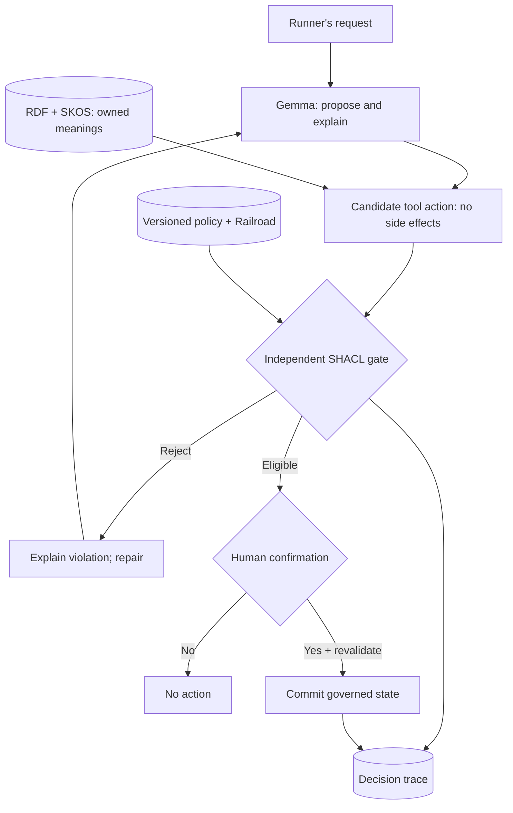

<div align="center">

### WordLift Lab · AOOE in Practice

# MERLINO 🏃

**An ontology-governed AI running coach.**

**Own the meanings. Govern the decisions. Choose the AI.**

[](#quickstart)
[](ontology/)
[](shapes/)
[](requirements-gemma.txt)
[](docs/RELEASE_APPROVALS.md)

*A hands-on reference implementation for **Agent-Oriented Ontology Engineering (AOOE)**.*

</div>

> **Pre-publication draft.** Bea's redistribution permission, WordLift licensing approval, and full Gemma/Colab/PySHACL integration checks are pending. Do not publish before [release approvals](docs/RELEASE_APPROVALS.md) are completed.

## Why Merlino?

An organization may own a powerful LLM and still lose control of its **meanings**: what counts as reliable evidence, a safe action, or an authorized decision. A prompt cannot establish that control.

**Merlino makes the boundary visible.** Gemma 4 plays the conversational running coach for a **fictional athlete**. RDF and SKOS describe the domain. A versioned Rulebook and **independent SHACL gate** validate candidate actions. Human approval is a separate step. The agent cannot rewrite its own rules or award itself permission.

This demonstrates **Semantic Sovereignty**: organizations control semantics, evidence, decisions, and data access even when language models change.

## One architecture, four responsibilities



**Gemma proposes · RDF defines · SHACL validates · humans authorize.**

## Quickstart

### 1. Guided notebook (CPU-first, Gemma optional)

Open [`notebooks/Merlino_Gemma4_AOOE_Workshop.ipynb`](notebooks/Merlino_Gemma4_AOOE_Workshop.ipynb) in [Google Colab](https://colab.research.google.com/) via its notebook upload or GitHub-import flow. The notebook includes its own educational source bundle.

<!-- Activate only once repo is public and the link is verified:
[](https://colab.research.google.com/github/wordlift/merlino/blob/main/notebooks/Merlino_Gemma4_AOOE_Workshop.ipynb)
-->

**Colab is a Google-managed VM, not an on-device or private deployment. Use only synthetic data.** No hosted LLM API is required for the CPU exercises. The optional Gemma model runs in the notebook runtime and requires a suitable GPU and model access agreement.

### 2. Python: real independent SHACL gate

```bash
python -m pip install -r requirements.txt
python -m pytest -q -ra
python -c 'from merlino.engine import Merlino; m=Merlino(); print(m.read_history().as_dict()); print(m.propose(42.5).as_dict())'
```

A missing validator makes the real engine fail closed. Tests explicitly identify any fake gate; no model or SHACL successes are fabricated.

## Three interactive experiments

1. **Describe meanings:** inspect Bea's [Map](ontology/merlin_map.ttl), the Railroad and the fictional athlete. How does `TempoRun` differ from an untyped text label?
2. **Govern actions:** request a **42.5 km** week for a runner with a **33 km** baseline; inspect the SHACL rejection and audit trace.
3. **Change meaning, not the prompt:** change whether `TempoRun` is considered a hard session; rerun the consecutive-hard-days scenario and inspect the changed result.

**The synthetic mileage policy is a teaching device, not running or medical advice.**

## From traditional ontology engineering to AOOE

| Level | Main deliverable | Merlino example | Enables |
| --- | --- | --- | --- |
| **Legend** | Controlled vocabulary, identity and pinned meanings | Workout terminology and identifiers | Addressability |
| **Map** | Domain model and competency questions | Athlete, sessions, plan, training evidence | Understanding and analysis |
| **Rulebook** | Validation, behavior, approval and trace | Railroad, BCS, SHACL, authorization | Governed agency |

Read the [public AOOE vocabulary](https://github.com/wordlift/aooe) for these levels. This educational prototype does **not** claim conformance to WordLift's private AOOE methodology gates.

## Semantic sovereignty and disclosure

| Component | Workshop default | Enterprise-sovereign version |
| --- | --- | --- |
| Model | Gemma 4 on Colab GPU (optional) | Privately hosted Gemma / replaceable model |
| Meaning + state | RDFLib, local to the notebook VM | Versioned WoGraph OSS deployment |
| Validation | PySHACL in a separate subprocess | Authenticated protected policy service |
| Approval | Explicit simulation | Verified identity and authorization |
| External services | Off by default | Scoped, audited WordLift Resolve / graph API |

WordLift Resolve sends only fixed synthetic labels when enabled and a temporary credential is supplied. No model weights, live credentials, personal histories, private WoCell code or private lab methodology are bundled.

## Explore

[Workshop agenda](docs/WORKSHOP.md) · [Facilitator's guide](docs/FACILITATOR.md) · [Architecture](docs/ARCHITECTURE.md) · [Behavioral specification](BCS.md) · [Privacy and security](docs/PRIVACY_AND_SECURITY.md)

## Credits and licensing

An educational WordLift Lab prototype based on **Bea's Merlin Running Pal** ontology and Railroad, extended with an independent gate, Gemma agent adapter, and sovereignty exercises. [Source notices](NOTICE.md) preserve the pending attribution and licensing review.

The [AOOE vocabulary](https://github.com/wordlift/aooe) is a separate CC BY 4.0 project. [WoGraph OSS](https://github.com/wordlift/wograph-oss) is a separately deployed runtime. Gemma model weights are not included and use Google's applicable terms.

**Licensing:** This repository already contains a WordLift MIT license. Bea-derived ontology and teaching content must not be made public until redistribution, attribution, and license compatibility are explicitly confirmed. This branch is private review material. See [release checklist](docs/RELEASE_APPROVALS.md).